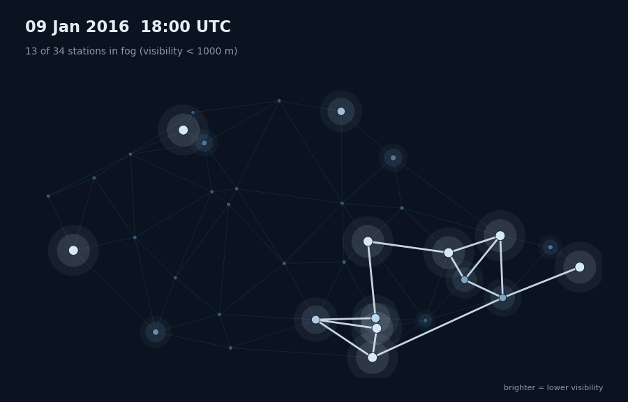
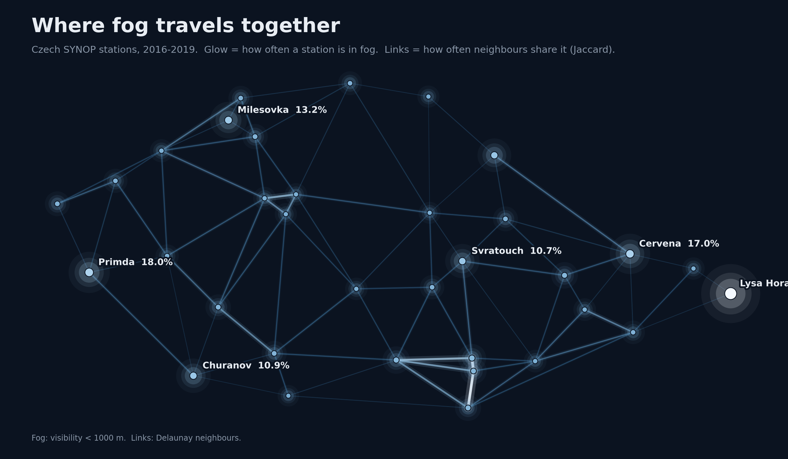
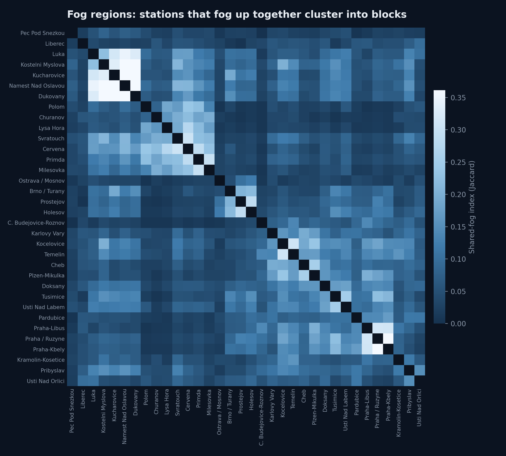
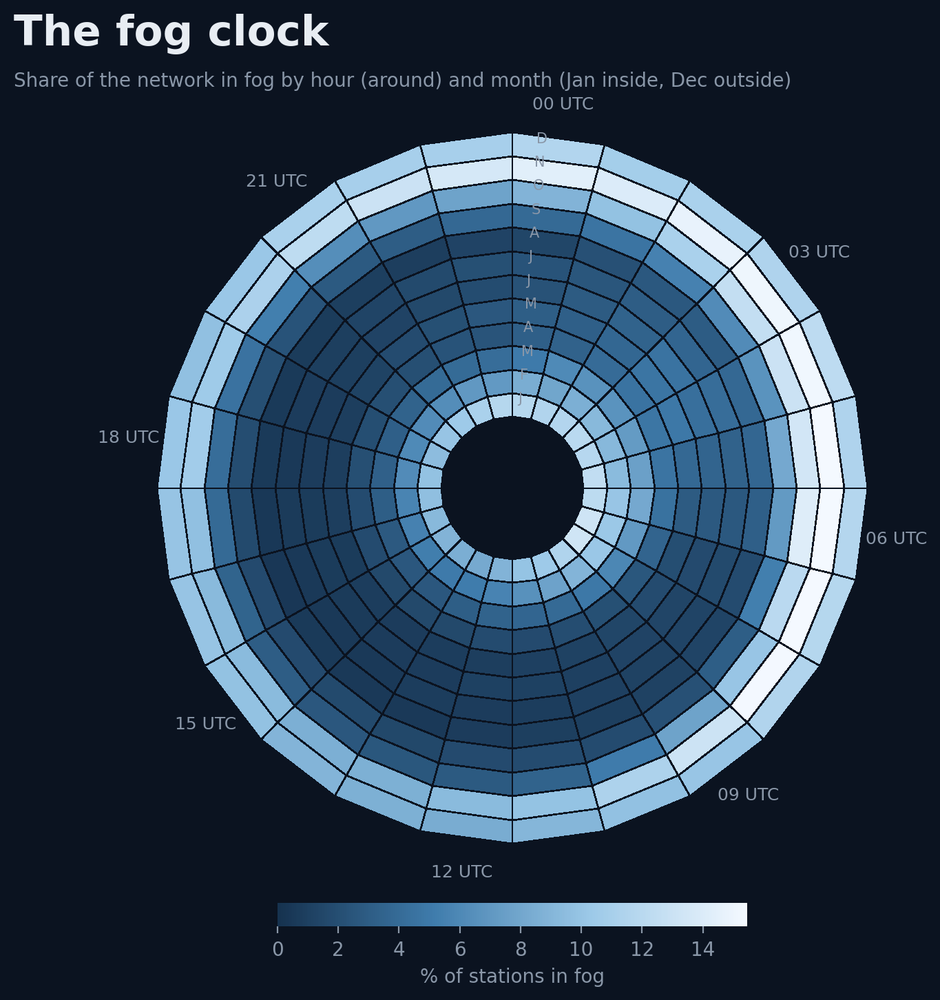

# fog-obs-fusion

Fusing surface observations, soundings and NWP to understand and forecast fog and visibility, built on a graph of Czech SYNOP stations.

[](https://colab.research.google.com/github/Sladekd/fog-obs-fusion/blob/main/notebooks/01_station_graph.ipynb) Station graph &nbsp;·

[](https://colab.research.google.com/github/Sladekd/fog-obs-fusion/blob/main/notebooks/02_fog_figures.ipynb) Fog figures

<p align="center"></p>
Example of the visualization of Fog Climatology:

<p align="center"></p>

<p align="center"></p>

<p align="center"></p>

## What is here

| Part | Status | What it does |
| --- | --- | --- |
| `fogfusion.io` | ready | Parse OGIMET station headers; turn decoded SYNOP tables into station × time matrices, fog labels and anomalies |
| `fogfusion.graph` | ready | Delaunay station graph in UTM 33N, pruning, connectivity; tests whether edges carry signal beyond distance |
| `fogfusion.viz` | ready | Graph diagnostics and four fog figures: fog web, fog regions, fog clock, foggiest-night GIF |
| `fogfusion.gnn` | started | Graph → `edge_index` / `edge_attr` arrays for PyTorch Geometric; GraphSAGE models planned |
| `fogfusion.upperair` | planned | Radiosonde diagnostics: inversions, mixing height, transport wind, T/Td/RH850, PWAT, CAPE/CIN |

See [ROADMAP.md](ROADMAP.md) for the phases ahead.

## Quick start

```bash
git clone https://github.com/Sladekd/fog-obs-fusion.git
cd fog-obs-fusion
pip install -e ".[dev]"
pytest
```

Put your decoded SYNOP table in `data/processed/` (format in [data/README.md](data/README.md)), then:

```bash
python scripts/build_graph.py      --obs data/processed/synop.parquet --out outputs/graph
python scripts/make_fog_figures.py --obs data/processed/synop.parquet --out figures
```

Or from Python:

```python
from fogfusion.io import load_stations, check_coverage, fog_matrix, anomalies
from fogfusion.graph import build_delaunay_graph, pair_stats, distance_matched

sg = build_delaunay_graph(check_coverage(obs, load_stations()))
print(sg.summary())

pairs = pair_stats(anomalies(obs, "visibility_m", log=True), fog_matrix(obs), sg.stations, sg.graph)
diff, _ = distance_matched(pairs, "fog_cooc")   # > 0: neighbours share fog beyond distance
```

## Method notes

- **Fog**: visibility below 1000 m in an hourly report. Missing reports stay missing; they are never counted as "no fog".
- **Graph**: Delaunay triangulation on projected coordinates (UTM 33N, km). Edges longer than the 95th percentile of edge length are pruned by default; these are mostly convex-hull artefacts.
- **Does the graph mean anything?** A full triangulation is always connected, so connectivity alone proves little. The real test compares edge pairs with non-edge pairs *at the same distance*, for log-visibility anomaly correlation (with the station's month × hour climatology removed) and for fog co-occurrence.
- **Shared fog** in the figures is the Jaccard index: hours both stations are in fog ÷ hours either is.

## Repository layout

```
src/fogfusion/
    io/          OGIMET parsing, SYNOP matrices, fog labels, anomalies
    graph/       Delaunay graph, edge-signal tests, Jaccard
    viz/         graph diagnostics, fog figures, dark style
    gnn/         graph arrays for PyTorch Geometric (models to come)
    upperair/    sounding diagnostics (interfaces only)
    resources/   bundled station table (36 Czech SYNOP stations)
scripts/         command-line entry points
notebooks/       Colab notebooks
tests/           pytest on synthetic data at real station positions
data/            local only, not committed
figures/         rendered figures for the README
```

## Data sources

SYNOP reports and station metadata: [OGIMET](https://www.ogimet.com). Planned: radiosondes from IGRA2 / University of Wyoming, reanalysis from ERA5 (Copernicus CDS), GFS analyses.

## License

MIT
